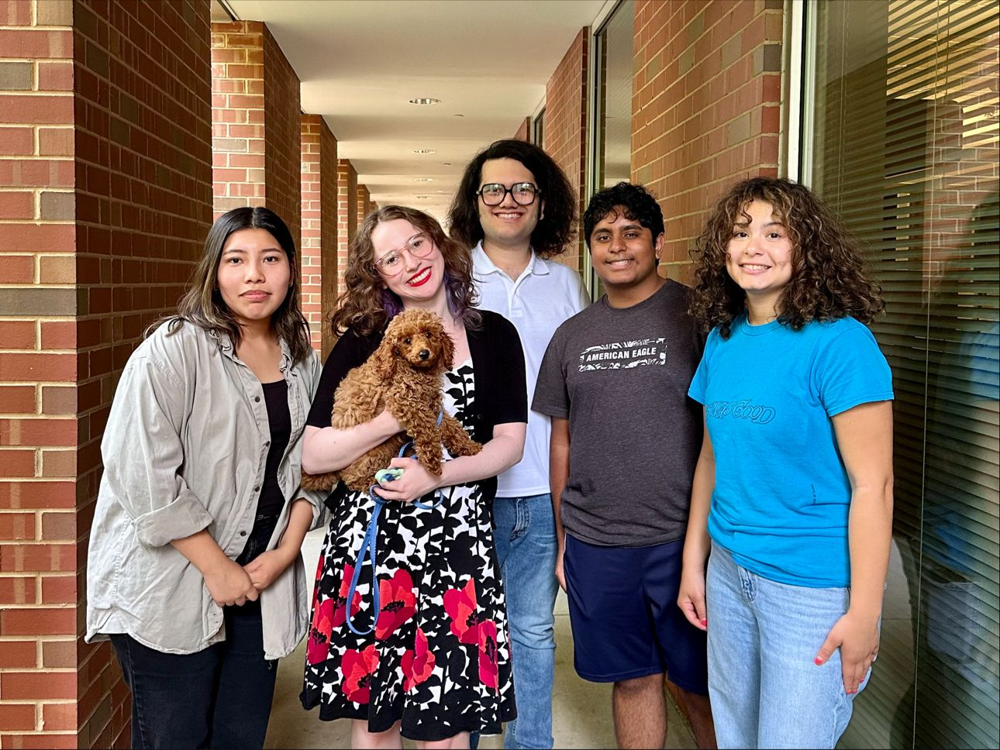




  {{ total_mentees }} mentees from 9 institutions

  Mentoring is one of my favorite parts of research. I work with undergraduates, master's students, and K-12
  teachers and I try to give every mentee ownership of a question they care
  about. Fourteen of my mentees have co-authored published or submitted work. One community-college mentee
  transferred to NC State and stayed on the project, and another is starting a Ph.D. In Summer 2026, seven undergraduate
  developers (two team leads and five developers) and nine K-12 teachers took part in ExLAIM, an ExLENT-funded program I
  lead, co-designing classroom tools for MerryQuery.

<figure class="text-center mb-5" style="max-width: 600px; margin: 0 auto;">
  
  <figcaption class="caption">
    Group Photo from Summer 2023: Yadhira Marcos-Avila, Heidi Reichert, myself, Shiva Gadireddy, and Samantha
    Gonzalez (from left to right)
  </figcaption>
</figure>

<h2>Undergraduate Researcher Interns</h2>



<h2>Teacher Research Interns</h2>



<h2>Graduate Developers</h2>



